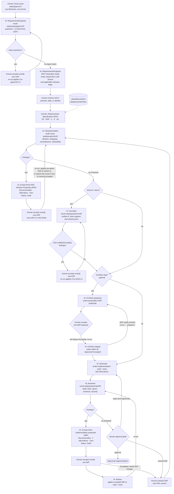
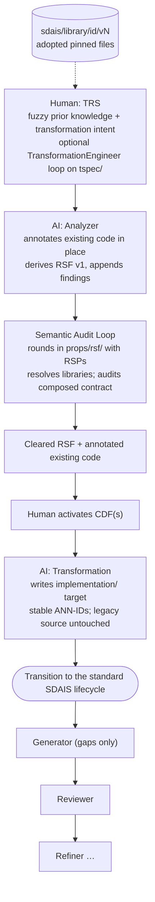

# SDAIS — Specification-Driven AI Synthesis

- **Date:** 2026-10-08
- **Version:** v0.14.0
- **Status:** Draft

---

## Idea

**Specification-Driven AI Synthesis (SDAIS)** is a software development paradigm in which humans author requirements exclusively, and AI agents synthesise, review, and refine all code. No human writes implementation code. The human role is that of architect and specifier; the AI role is that of implementer, reviewer, and annotator.

The name reflects the three load-bearing elements:

- **Specification-Driven** — a structured, versioned requirements document is the single upstream artefact and the authoritative source of truth. All AI activity is derived from and traceable to it.
- **AI** — one or more AI agents execute the full development lifecycle: generation and test authoring, annotation, review including test execution and security audit, and refinement.
- **Synthesis** — the output is not a translation of human code, but a synthesis from requirements. The AI selects structure, idioms, and implementation strategy within the constraints given.

---

## Reasoning

Traditional AI-assisted development treats AI as a tool inside a human workflow. The human retains code authorship; AI accelerates specific tasks. SDAIS inverts this: the human retains specification authorship; AI owns the implementation artifact entirely.

This inversion produces several consequences:

**All implicit knowledge must become explicit.** A human developer encodes architectural intent, naming rationale, and edge-case handling implicitly while writing code. In SDAIS, that knowledge must be stated in the specification or it does not exist. This raises the quality bar for requirements — and produces better-defined systems as a side effect.

**Annotations become the cross-session memory of the AI.** Because LLMs are stateless between invocations, the structured annotations embedded in generated code are the only mechanism by which a subsequent agent understands what a prior agent intended. Annotations are not documentation; they are the inter-agent protocol.

**The programming language is a constraint, not a presumption.** The specifier states the target language as a hard constraint, or leaves it unconstrained and lets the AI select. This makes the specification language-agnostic by default.

**Refinement is a loop, not a one-shot operation.** AI agents generate, review, and refine in cycles. Each cycle uses annotations from the prior cycle as its specification. The loop terminates when a review agent finds no violations and all acceptance criteria pass, or when a human approval gate is reached.

**The annotation language is the AI-to-AI handoff protocol.** It derives from Design by Contract (Meyer/Eiffel) — preconditions, postconditions, constraints — but is extended with traceability labels for multi-agent context. It operates at four scope levels: library, package, type, function.

**Requirements and adopted libraries compose the implementation contract.** Human-authored RSF decides whether and where a library applies. An adopted, pinned library file defines the referenced contract details. Approved ADF may explain and structure the solution, but may not weaken either authority. Implementation must satisfy the composed RSF plus library contract. RSF and an adopted library are complementary, not winner/loser alternatives: a contradiction between them blocks synthesis and must be reported by the SemanticAuditor. When ADF and generated code disagree without an RSF or library conflict, the ADF wins. No agent may silently reconcile a conflict.

---

## Agent Environment and Model Contract

SDAIS is environment-agnostic: any AI agent system that can read and write files and maintain coherent context across a session is a valid execution environment. The following constraints apply regardless of platform.

### Minimum Capability Requirements

An agent is suitable for any SDAIS role if it:

- Can read and write Markdown files of arbitrary size within a single invocation.
- Maintains sufficient context to process all active RSF items and annotated source files for the current version without truncation.
- Produces structurally stable outputs — the same inputs on successive runs must not produce different artefact shapes unless the RSF changed.

The Reviewer additionally needs shell execution: it builds the implementation and runs the complete test suite every round. A Reviewer that cannot execute them reports `Result: Blocked` and never `Cleared`. Generator and Refiner run the build and tests when they can, but only to report the result.

### Recommended Model Tiers

Pin the model version used for each agent in your project's `AGENTS.md` or equivalent configuration. Version drift between rounds — using a different model for round N+1 than for round N — can produce inconsistent finding interpretations.

| Role | Minimum recommended tier | Reason |
|---|---|---|
| RequirementsEngineer | High reasoning (e.g. Claude Opus) | Ambiguity detection in free-form prose and requirement derivation benefit from deeper inference |
| TransformationEngineer | High reasoning (e.g. Claude Opus) | Ambiguity and Confidence elicitation in legacy-system prose require deeper inference |
| SemanticAuditor | High reasoning (e.g. Claude Opus) | Ambiguity detection benefits from deeper inference |
| Generator, Refiner, Analyzer, Transformation | High coding ability (e.g. Claude Sonnet) | Code and test synthesis and annotation precision are primary demands |
| Reviewer | High reasoning (e.g. Claude Opus) | Specification, test, and security review plus coherent Solution Proposals determine loop convergence speed |
| Architect, Grounder | High reasoning (e.g. Claude Opus or Sonnet) | Architecture decisions and infrastructure validation require sound judgment |

### Agent Output Storage

Specification and workflow outputs are files on disk within the `sdais/` tree.
Agent-managed product artefacts are files on disk within the active
implementation root. No agent output is authoritative unless written to a
file and committed to version control. The `sdais/` tree, the implementation
workspace, and git history together form the complete audit trail. External
execution logs (API transcripts, tool call records) are supplementary and may
be stored in `sdais/logs/` if retention is required; they are never read by any
agent.

---

## Directory Structure

Every SDAIS project places all specification and workflow artefacts under an
`sdais/` directory at the project root. The `AGENTS.md` file lives at the
project root as usual. Fresh projects place the complete agent-managed product
workspace under `implementation/`.

```
<project-root>/
├── AGENTS.md
├── implementation/          ← agent-managed product workspace
│   ├── .sdais-root          ← zero-byte managed-root activation marker
│   └── <language-native project tree>
└── sdais/
    ├── SDAIS.md              ← paradigm specification (distribution file)
    ├── prompts/              ← installed by install; refreshed by update
    │   ├── requirements-engineer.md
    │   ├── transformation-engineer.md
    │   ├── semantic-auditor.md
    │   ├── grounder.md
    │   ├── architect.md
    │   ├── generator.md
    │   ├── reviewer.md
    │   ├── refiner.md
    │   ├── analyzer.md
    │   └── transformation.md
    ├── library/              ← project-owned, versioned reference contracts
    │   └── <library-id>/
    │       └── v<N>/         ← immutable version; one or more UTF-8 text files
    ├── gspec/
    │   ├── v1/
    │   │   └── <anything>.md ← initial loose prose; any filename, any format
    │   └── v2/
    │       └── <same names>  ← snapshot written when the RequirementsEngineer applies an accepted proposal
    ├── tspec/
    │   ├── v1/
    │   │   └── <anything>.md ← initial prose about existing system + desired changes
    │   └── v2/
    │       └── <same names>  ← snapshot written when the TransformationEngineer applies an accepted proposal
    ├── rsf/
    │   ├── v1/
    │   │   ├── fr-0000-template.md       ← template; copy to start a new FR
    │   │   ├── nfr-0000-template.md      ← template; copy to start a new NFR
    │   │   ├── c-0000-template.md        ← template; copy to start a new Constraint
    │   │   ├── e-0000-template.md        ← template; copy to start a new Environment item
    │   │   ├── ac-0000-template.md       ← template; copy to start a new AC
    │   │   ├── fr-0001-<short-description>.md
    │   │   ├── fr-0002-<short-description>.md
    │   │   ├── nfr-0001-<short-description>.md
    │   │   ├── c-0001-<short-description>.md
    │   │   ├── e-0001-<short-description>.md
    │   │   └── ac-0001-<short-description>.md
    │   └── v2/
    │       └── ...            ← only items new or amended in v2
    ├── props/                  ← Solution Proposals; one dir per round and agent
    │   ├── gspec/v<R>/           ← RequirementsEngineer rounds (GSP)
    │   ├── tspec/v<R>/           ← TransformationEngineer rounds (TSP)
    │   ├── rsf/v<R>/             ← SemanticAuditor rounds (RSP)
    │   ├── env/v<R>/             ← Grounder rounds (ESP)
    │   ├── adf/v<R>/             ← Architect rounds (ADP)
    │   └── impl/v<R>/            ← Reviewer rounds (IMP), applied by the Refiner
    │       ├── report.md                 ← findings or context; Result field
    │       ├── prop-a-<short-slug>.md    ← Recommended proposal
    │       ├── prop-b-<short-slug>.md    ← Alternative proposal
    │       ├── prop-c-<short-slug>.md    ← second Alternative (required for impl)
    │       └── prop-own.md               ← template for the human's own proposal
    ├── adf/                    ← Architecture Definition Files; produced by Architect
    │   ├── v1/                 ← ADF set for round 1 (all Approved+Accepted)
    │   │   ├── adf-01-context-and-goals.md
    │   │   ├── adf-02-internal-architecture.md
    │   │   ├── adf-03-external-architecture.md
    │   │   ├── adf-04-requirement-trace.md
    │   │   ├── adf-05-glossary.md
    │   │   └── decisions/
    │   │       └── adr-0001-<short-title>.md
    │   └── v2/                 ← ADF set for round 2 (round 1 preserved as history)
    │       └── ...
    ├── trs/
    │   ├── v1/
    │   │   ├── trs-fr-0000-template.md   ← template; copy to start a new TRS-FR
    │   │   ├── trs-nfr-0000-template.md  ← template; copy to start a new TRS-NFR
    │   │   ├── trs-c-0000-template.md    ← template; copy to start a new TRS-C
    │   │   ├── trs-fr-0001-<short-description>.md
    │   │   └── ...
    │   └── v2/
    │       └── ...
    ├── cdf/
    │   ├── v1/
    │   │   ├── lang-0001-<short-description>.md
    │   │   └── ...
    │   └── v2/
    │       └── ...
```

**Version directory semantics:**

- Each `gspec/v<N>/` directory is an immutable, complete prose snapshot. The human writes `gspec/v1/`; the RequirementsEngineer writes `gspec/v<N+1>/` only when it applies the proposal the human accepted in `props/gspec/`. Spec files contain prose only. The highest version whose round reports `Cleared` is the clean spec used for RSF generation.
- Each `tspec/v<N>/` directory follows the same rules for the TransformationEngineer, with its rounds in `props/tspec/`; the highest clean version is used for TRS and CDF generation.
- Each `rsf/v<N>/` directory contains all RSF items that are new or amended in version N. Items unchanged since their introduction remain in their original version directory and are still authoritative. A new RSF version is written by the human, by the RequirementsEngineer, or by the SemanticAuditor or Grounder when it applies an accepted Solution Proposal. Analyzer findings are appended as `## Findings` sections within the staged copies in `rsf/v<N+1>/`.
- Each `props/<domain>/v<R>/` directory is one round of the agent owning that domain: `report.md` with all questions or findings of the round and, when there are any, at least three Solution Proposals with status Draft. Rounds are immutable history except for the status changes defined in Solution Proposals.
- Each `trs/v<N>/` directory contains TRS items introduced or amended in version N. Version semantics match those of `rsf/`.
- Each `cdf/v<N>/` directory contains CDF files for that transformation pass. CDFs are not versioned like RSF items; a new version directory is used when a new transformation pass is initiated.
- Each `props/adf/v<R>/` directory is one Architect round: `report.md` with the architectural context and Result (`Proposed` when proposals are written; `Applied` after the accepted proposal has been applied), plus ADP proposal files following the same conventions as other agent proposals.
- Each `props/impl/v<R>/` directory is one Reviewer round: `report.md` with the build and test results, all findings, open escalations, and Result (`Cleared`, `Findings`, `Blocked`, or `Applied` after the Refiner applied the accepted proposal), plus IMP proposals. See Implementation Review Loop.
- Each `adf/v<R>/` directory is the applied ADF set for round R: five core documents (all Status=Approved) and ADRs (all Status=Accepted) under `decisions/`. R matches the `props/adf/v<R>/` round whose accepted proposal was applied; previous rounds are preserved as history. The five core filenames carry `adf-01-` through `adf-05-` prefixes so lexical order matches reading order. The directory is absent if the Architect step was skipped. Every file is UTF-8 Markdown.
- Each `library/<library-id>/v<N>/` directory is a published version of a project-owned reference library. Published version directories are immutable; amendments create `v<N+1>/`. The entire `library/` directory may be absent or empty when no requirement uses it.
- The distribution is `sdais-vX.Y.Z.tgz`. It contains `SDAIS.md`, `README.md`, `CHANGELOG.md`, `LICENSE`, `install.sh`, `update.sh`, `sdais.sh`, `docs/`, and `scaffold/`, and expands directly into the current directory. Create a project root, copy or download the archive into it, run `tar xzf sdais-vX.Y.Z.tgz`, then run `./install.sh <project-name>` once to scaffold the project. To upgrade, unpack the new archive in the existing project root and run `./update.sh --from <old-version>`. Run `./sdais.sh <tool> <model> <role>` to launch any agent.
- The `prompts/` directory is installed by `install` and refreshed by `update`.

### Implementation Root

The canonical implementation root is `implementation/` at the project root.
Managed-root mode is active only when the zero-byte marker
`implementation/.sdais-root` exists. The root name is fixed in v0.13.0 and is
not configurable.

In managed-root mode every product artefact written by Generator,
Transformation, or Refiner stays under `implementation/`.
This includes source code, tests, module and package manifests, dependency lock
files, fixtures, static assets, database migrations, build and deployment
configuration, and product documentation. Language-native layout begins
inside the root; for example a Go implementation uses
`implementation/go.mod`, `implementation/cmd/`, and
`implementation/internal/`. `generated/` is not used because the committed,
reviewed implementation is authoritative project content, not disposable
build output. Agents must not create product artefacts beside `AGENTS.md`, the
SDAIS distribution files, or `sdais/`.

The marker is an activation sentinel, not configuration. Fresh installation
creates the directory and marker. Update never creates either for an existing
unmarked project, never moves code, and never rewrites anything under an
existing `implementation/`. An unmarked project retains legacy repository-wide
and in-place behaviour exactly as before. To migrate deliberately, the human
moves the complete implementation workspace into `implementation/` and creates
the zero-byte marker last. Directory existence without the marker does not
activate managed-root mode.

For SDAIS-T in managed-root mode, existing legacy source may remain outside
`implementation/`. Analyzer may read and add annotations to that source in
place. Transformation writes the complete transformed target under
`implementation/` and never deletes the legacy source. If the source already
lives under `implementation/`, Analyzer and Transformation operate there.
After a transformed target exists, Generator gap-filling, Reviewer, and
Refiner read or write only the managed target.

The implementation-root rule controls repository placement, not runtime file
paths used by the product. An RSF, adopted library, or ADF decision that
requires a repository product artefact outside the active managed root
contradicts this workflow. SemanticAuditor reports `CONTRADICTORY`; synthesis
and transformation stop rather than silently writing outside the root.

### Versioned Reference Libraries

A **library artifact** is human-authored, local, versioned reference material that defines a reusable contract, language, protocol, schema, notation, design system, or interface. It is not requirement prose. Its existence never creates an FR, NFR, C, E, or AC, and agents do not load every library into global context.

The canonical layout is `sdais/library/<library-id>/v<N>/<reference-file>`, where `<library-id>` is stable lower-case kebab-case, `v<N>` is an explicit positive integer version, and reference files are UTF-8 text suitable for humans and agents. A published version is immutable. Remote contracts needed for reproducibility must first be captured as a local, reviewed snapshot; agents never fetch live definitions.

A requirement adopts a library only through an explicit `**Libraries:**` header. Each comma-separated entry is a project-root-relative path naming a concrete file, optionally followed by a Markdown heading anchor:

```markdown
- **Source:** sdais/gspec/v3/ui.md
- **Libraries:** sdais/library/tds/v1/tds.md#8-workspace-and-coordinates
```

`Source` records provenance; `Libraries` records normative supporting contracts. They are never interchangeable. When `Source` exists, `Libraries` immediately follows it; otherwise it follows `Last modified`. The field is omitted when an item adopts no library. Unchanged items without it remain valid.

A valid pinned reference stays under `sdais/library/<library-id>/v<N>/`, contains an exact positive version and concrete filename, and resolves to an existing readable file and optional heading. URLs, absolute paths, floating `latest` aliases, unversioned or directory-only paths, path traversal, and references outside `sdais/library/` are invalid. Local relative links inside a library may resolve only within the same version directory unless the link target is itself a valid pinned library reference. Agents read only the files reachable from active adopted references, retain those files as their own source of truth, and link to rather than copy large portions into RSF, ADF, annotations, code comments, or findings. Short paths such as `library/tds/v1/tds.md` are interpreted relative to `sdais/`; canonical fields use the full project-root-relative form.

**File naming — why no date in the filename:**
Earlier versions of SDAIS embedded the authoring date in filenames (e.g. `rsf-myproject-v1-2026-04-21.md`) to timestamp versions without relying on version control. In the current structure each file carries its date in its header metadata, and git history is the authoritative timeline. Dates do not appear in filenames.

---

## Lifecycle



RSF amendments increment the version and restart the loop from the semantic
audit. The prior annotated implementation workspace is not discarded — it
becomes input context for the next generation pass.

Human prose or directly authored RSF may explicitly adopt a pinned file under `sdais/library/`. The RequirementsEngineer preserves the smallest applicable reference set on generated items; the SemanticAuditor resolves each reference and audits the composed contract. Architect, Generator, Reviewer, and Refiner then read those same pinned files. Library existence alone adds no context and produces no requirement.

For SDAIS-T (transformation of existing systems), the lifecycle starts at the
SDAIS-T section (see below) and joins the standard SDAIS-G lifecycle at the
Generator stage. In managed-root mode the annotated legacy source and RSF are
Transformation inputs; its complete target under `implementation/` is the
input to Generator gap-filling and the standard review loop.

---

## Usage Guide

### Step −1 — Initialise the Project

Before authoring any RSF items, run `install` from the project root to scaffold the `sdais/` directory tree:

```
./install <project-name>
```

This copies `SDAIS.md` to `sdais/SDAIS.md`, installs all prompt files into
`sdais/prompts/`, installs all `*-0000-template.md` files, creates an empty
project-owned `sdais/library/`, creates
`implementation/.sdais-root` to activate managed-root mode, and writes
`AGENTS.md` at the project root with the project name substituted. No
project-specific library content ships in the scaffold.

To launch an agent from the project root, use `./sdais.sh`:

```
./sdais.sh
./sdais.sh <tool> <model> <role>
```

Without arguments the launcher prints an interactive menu listing every role with the recommended reasoning or coding model per tool. Each entry has a menu code — `C01`–`C10` (Claude), `X01`–`X10` (Codex), `G01`–`G10` (Gemini), `O01`–`O10` (Ollama), numbered in workflow order starting with RequirementsEngineer — and the user selects the next step by entering that code. Default models can be overridden with `SDAIS_<TOOL>_REASONING` and `SDAIS_<TOOL>_CODING`.

For a direct launch, for example: `./sdais.sh claude claude-opus-5-5 SemanticAuditor`. The launcher accepts the role as CamelCase (`SemanticAuditor`) or kebab-case (`semantic-auditor`). Supported tools: `claude`, `codex`, `gemini`, `ollama`. Run from the project root.

### Step −1b — Update Scaffolding to a New SDAIS Version

When upgrading to a new SDAIS version, replace `SDAIS.md`, `install`, and `update` (and the tgz or `scaffold/` directory) with the new release, then run from the project root:

```
./update --from <old-version>
```

`update` replaces all scaffold files while leaving all project content untouched.

**What is scaffolding vs. project content:**

| Refreshed by update | Left untouched |
|---|---|
| `AGENTS.md` (Custom Agents Extension preserved) | `sdais/gspec/v*/*.md` |
| All files in `sdais/prompts/` | `sdais/tspec/v*/*.md` |
| All `*-0000-template.md` files | `sdais/rsf/v*/fr-NNNN-*.md` (NNNN ≥ 0001) |
| `sdais/SDAIS.md` | `sdais/rsf/v*/nfr-NNNN-*.md` (NNNN ≥ 0001) |
| | `sdais/rsf/v*/c-NNNN-*.md` (NNNN ≥ 0001) |
| | `sdais/rsf/v*/e-NNNN-*.md` (NNNN ≥ 0001) |
| | `sdais/rsf/v*/ac-NNNN-*.md` (NNNN ≥ 0001) |
| | `sdais/trs/v*/*.md` |
| | `sdais/cdf/v*/*.md` |
| | `sdais/adf/v*/*.md` |
| | `sdais/library/**` (all project-owned versions and files) |
| | `implementation/**` (including `.sdais-root`) |
| | All legacy source code outside `implementation/` |

Update does not add `implementation/.sdais-root` to an unmarked legacy project.
Such a project remains in legacy mode until the human completes the documented
migration and creates the marker.

---

### Step 0 — Requirements Engineering (optional)

This step is optional. If you prefer to author RSF items directly, skip to
Step 1. Use this step when you have rough ideas but struggle to write formal
requirements from scratch.

#### Step 0.1 — Write initial specification prose

Create `sdais/gspec/v1/` and write one or more files describing what the system
should do. No filename convention or structure is required — bullet points,
paragraphs, conversation fragments, or any other form are all accepted.

#### Step 0.2 — Run the RequirementsEngineer

Run the RequirementsEngineer from the project root with the prompt from
`sdais/prompts/requirements-engineer.md`. Each run is one clarification
**round** written to `sdais/props/gspec/v<R>/` (see
[Solution Proposals](#solution-proposals)):

- `report.md` lists every question that blocks deterministic RSF generation —
  undefined terms, vague or unbounded wording, contradictions, behaviour
  without a success criterion, quality attributes without a numeric bound,
  missing context, and informally named libraries — each with the quoted
  passage it concerns.
- At least three **gspec Solution Proposals (GSP)** with status `Draft`
  answer all questions at once: `prop-a-*` (Recommended), `prop-b-*`
  (Alternative, optionally `prop-c-*`), and `prop-own.md` (a template for your
  own answers). Each proposal states its strategy, one answer per question, the
  exact prose changes per spec file, the impact on other passages, and its
  compromises — narrowed scope, deferred features, dropped wishes, or
  assumptions it made.

The spec files themselves stay pure prose: no markers or question sections are
written into them.

The agent also recognizes explicit pinned references such as
`sdais/library/tds/v1/tds.md`. It reads a referenced file to understand its
defined terms, preserves the reference and its scope through later prose
versions, and asks a question when a library is named informally, lacks an
exact version or file, or has unclear adoption scope. A library file is never
treated as another gspec input and never generates requirements by itself.

#### Step 0.3 — Accept one proposal

Set `**Status:** Accepted` in exactly one proposal; you may edit it first. To
use your own answers, complete `prop-own.md`, replacing every
`{{placeholder}}`, and accept it. Feedback for the next round may be written
under `## Notes`.

Re-run the RequirementsEngineer. It applies the accepted proposal to a new
snapshot `sdais/gspec/v<N+1>/`, marks it `Applied` and the other proposals
`Rejected`, and analyses the new version. Accepting none or more than one
rejects the whole round and yields substantially different proposals. Answers
and compromises of an applied proposal are binding and are not asked again.

Files from earlier SDAIS versions that still contain `[[QN]]` markers or a
`## Questions` section are accepted: answered entries count as spec text, open
ones become questions of the next round, and the next snapshot is written
without them.

#### Step 0.4 — RSF Generation

When a round reports `Result: Cleared` the RequirementsEngineer generates the
RSF in the same run. It reads the clean spec files and writes one RSF
item file per derived requirement into `sdais/rsf/v1/`. Each generated item
carries a `**Source:**` field listing the spec file(s) it was derived from and,
when applicable, a `**Libraries:**` field containing only the pinned references
that govern that item.

#### Step 0.5 — Human review of generated RSF

Review every item in `sdais/rsf/v1/`:

- Amend wording that is technically correct but does not match your intent.
- Delete items that are artefacts or duplicates.
- Add items the RequirementsEngineer could not derive (it can only work from
  what is in the spec prose).

The `**Source:**` field is the audit trail linking each RSF item back to human
intent. Do not delete it.

When satisfied with `sdais/rsf/v1/`, proceed to Step 1 to refine the items, or directly to Step 2 to audit them.

---

### Step 1 — Requirements Specification (RSF)

Each RSF item is one Markdown file in `sdais/rsf/v<N>/`. The prefix encodes the item type:

| Prefix | Type |
|---|---|
| `fr-NNNN-` | Functional Requirement |
| `nfr-NNNN-` | Non-Functional Requirement |
| `c-NNNN-` | Constraint |
| `e-NNNN-` | Environment |
| `ac-NNNN-` | Acceptance Criterion |

**RSF item file format:**

```markdown
# FR-0001: Short Title of the Requirement

- **Type:** Functional Requirement
- **Status:** Active
- **Introduced:** v1 (2026-04-21)
- **Last modified:** v1 (2026-04-21)
- **Source:** sdais/gspec/v3/auth-requirements.md
- **Libraries:** sdais/library/example-api/v2/openapi.yaml#paths

## Requirement

The service must authenticate requests using an API key supplied in the
`X-API-Key` HTTP header. Requests without a valid key must be rejected
with HTTP 401.

Related: [FR-0003], [NFR-0002], [AC-0001]
```

The `**Source:**` field records which spec file(s) are the primary reason for
this item. It is written by the RequirementsEngineer when generating RSF items
from prose; it may be omitted when a human authors an RSF item directly without
going through Step 0.

The optional `**Libraries:**` field records exact pinned supporting contracts.
Multiple references are comma-separated. It immediately follows `Source`, or
`Last modified` when `Source` is absent. Paths and anchors must resolve before
Cleared status; items without the field remain valid.

Environment (`E-`) items carry an additional field set by the Grounder:

```markdown
# E-0001: Short Title of the Environment Item

- **Type:** Environment
- **Status:** Active
- **Introduced:** v1 (2026-04-21)
- **Last modified:** v1 (2026-04-21)
- **Libraries:** sdais/library/deployment-schema/v1/environment.md
- **Verified:** Pending

## Requirement

<description of the runtime or deployment environment element>

Related: [FR-NNNN]
```

`**Verified:**` values: `Pending` (initial, set by human at authoring), `true` (confirmed by Grounder), `false` is not used — an unconfirmed element produces an `ENV-UNRESOLVABLE` finding appended to the item file and the field remains `Pending`.

**Rules:**
- The `## Requirement` section text is the authoritative, current formulation. When an item is fixed in place the section text is rewritten; the old wording is not preserved above the `—` separator (the applied RSF Solution Proposal, any `## Findings` section, and git history preserve the rationale).
- Items that are Dropped or Superseded set `Status:` accordingly and retain their `## Requirement` text as a tombstone.
- Cross-references use `[FR-NNNN]`, `[NFR-NNNN]`, `[AC-NNNN]`, etc. without version — they resolve to the most recent active version of the referenced item.

---

### Step 2 — Semantic Audit Loop

Before any code is generated the RSF must pass a semantic audit. The SemanticAuditor never edits an existing RSF version. Each run is one **audit round** written to `sdais/props/rsf/v<R>/` (see [Solution Proposals](#solution-proposals)). Instead of asking the human to resolve every finding separately, which tends to produce ever more detailed follow-up questions, the auditor proposes complete solutions for the RSF as a whole: **RSF Solution Proposals (RSP)**. The human accepts exactly one of them, and the auditor applies it verbatim in the next round.

#### Step 2.1 — Run the SemanticAuditor

Run the `SemanticAuditor` from the project root. Use the prompt from `sdais/prompts/semantic-auditor.md`. In each round the agent:

1. **Settles the previous round.** If the previous round has exactly one proposal with `**Status:** Accepted`, it writes that proposal's changes into `rsf/v<N+1>/`, sets the proposal to `Applied`, and sets all other proposals of that round to `Rejected`. If no proposal or more than one proposal is Accepted, or the accepted proposal is incomplete, all proposals of that round become `Rejected` and the RSF stays unchanged.
2. **Audits** the active RSF and its adopted libraries.
3. **Writes round `v<R+1>`**: `report.md` with every finding of the round and the result (`Cleared` or `Findings`). When there are findings, it also writes at least three proposals, all with status `Draft`:
   - `prop-a-<slug>.md`: **Recommended**, the simplest coherent resolution.
   - `prop-b-<slug>.md` (and optionally `prop-c-<slug>.md`): **Alternative**, a solution with a different strategy.
   - `prop-own.md`: **Own**, a template in which the human writes their own solution.

Finding categories: `AMBIGUOUS | INCOMPLETE | CONTRADICTORY | INFEASIBLE | UNTESTABLE | UNQUANTIFIED | LIBRARY-UNRESOLVABLE`.

#### Step 2.2 — Choose one proposal

Read `report.md` and the proposals. Each proposal covers every finding of the round and documents:

- its **Strategy**, the single idea that makes the resulting RSF homogeneous;
- its **Changes**, the exact new requirement text for each affected item, with the findings each change resolves;
- its **Impact** on requirements it does not change, such as ACs of changed FRs, NFRs sharing a bound, or items citing a dropped item;
- its **Compromises**: every weakened bound or acceptance criterion (for example speed, memory, or precision), every dropped requirement, and every waived finding, each with the reason it is acceptable.

Accept exactly one proposal by changing its `**Status:** Draft` to `**Status:** Accepted`. You may edit a proposal before accepting it; the auditor applies it exactly as it then reads. To use your own solution, complete `prop-own.md`, replacing every `{{placeholder}}`, and accept it. Feedback for the next round may be written under `## Notes` in any proposal.

| Change action | Effect when the proposal is applied to `rsf/v<N+1>/` |
|---|---|
| **Fix** | Item kept; requirement text replaced by the change text |
| **Weaken** | Item kept with a deliberately looser bound or criterion; the reason is listed under Compromises |
| **New** | New item with the next free number in its prefix group |
| **Supersede** | New item from the change text; old item kept as a tombstone with `Status: Superseded` |
| **Split** | One new item per part; old item kept as a tombstone with `Status: Split` |
| **Drop** | Item kept as a tombstone with `Status: Dropped`; the reason is listed under Compromises |
| **Waive** | No file change; the finding is acknowledged and the reason is listed under Compromises |

**Rules for RSF item IDs:**
- IDs are never reused. A dropped, superseded, or split item remains as a tombstone with `Status: Dropped`, `Status: Superseded`, or `Status: Split`.
- New items introduced during an amendment use the next available sequential number in their prefix group.

#### Step 2.3 — Re-run until Cleared

- Re-run the SemanticAuditor after accepting a proposal. It applies the proposal and audits the new RSF version.
- If you accept none, or more than one, the next round rejects the whole set and offers new proposals that differ in substance from every proposal rejected since the last applied one, taking your `## Notes` into account.
- Compromises and waivers in an applied proposal are binding human decisions; later rounds never raise them again as findings unless a later change contradicts them.
- When a round reports `Result: Cleared`, proceed to Step 3 if the RSF contains any active `E-` items, otherwise to Step 4 (optional) or Step 5.

An active item with an unresolved `**Libraries:**` entry cannot be Cleared.
`LIBRARY-UNRESOLVABLE` changes repair or remove only the reference and never
invent adoption intent. Contradictions between an RSF item and its library,
between adopted libraries, or between an AC and its library use
`CONTRADICTORY`, not `LIBRARY-UNRESOLVABLE`.

---

### Step 3 — Infrastructure Grounding (mandatory when `E-` items are present)

Run the Grounder agent when any active `E-` item exists in the cleared RSF. Use the prompt from `sdais/prompts/grounder.md`.

The Grounder reads every `E-` item and attempts to confirm that each named infrastructure element (database, service endpoint, message queue, file path, API, etc.) exists and matches the item description. For each confirmed element it sets `**Verified:** true` in place. Each run is one grounding **round** written to `sdais/props/env/v<R>/` (see [Solution Proposals](#solution-proposals)):

- `report.md` lists the confirmed elements and one `ENV-UNRESOLVABLE` finding per element that could not be confirmed, including what was observed instead.
- With findings, at least three **environment Solution Proposals (ESP)** with status `Draft`: Recommended, Alternative, and Own. Each resolves all findings coherently and documents its impact on dependent requirements and its compromises.

| Change action | When it is offered | Effect when applied |
|---|---|---|
| **Fix** | The element exists under a different name, location, or shape | `E-` item text aligned with what was observed; re-verified in the same run |
| **Weaken** | A dependent requirement can live with less of the element | Item kept with a looser requirement; listed under Compromises |
| **New** | A replacement element or constraint is needed | New item with the next free number |
| **Drop** | The element does not and will not exist | `E-` item and every dependent item dropped or weakened in the same proposal; listed under Compromises |
| **Provision** | The element is created by this project | No requirement change; recorded as a binding waiver and not verified again |

Accept exactly one proposal and re-run the Grounder. It writes the changes to `sdais/rsf/v<N+1>/`, marks the proposal `Applied`, and verifies again. If the applied proposal changed anything other than `E-` items, re-run the SemanticAuditor on the new version first.

Library files are not infrastructure and are never converted to E-items. The
Grounder may read an adopted contract only when needed to understand an E-item;
the SemanticAuditor remains responsible for reference validation.

When a round reports `Result: Cleared`: proceed to Step 4 (optional) or Step 5.

The full prompt is in `sdais/prompts/grounder.md`.

---

### Step 4 — Architecture Definition (optional)

Step 4 is optional and skipped unless either of the following conditions holds:
- The cleared RSF contains at least one `C-` item that explicitly requires design approval (i.e., its text calls for architectural sign-off before code is generated).
- The human explicitly invokes the Architect.

When Step 4 runs, provide all cleared RSF items and the library files reachable from their `**Libraries:**` fields to the Architect agent. Use the prompt from `sdais/prompts/architect.md`.

The Architect uses the standard **Solution Proposal** mechanism shared with RequirementsEngineer, SemanticAuditor, and Grounder: it writes architecture proposals to `sdais/props/adf/v<R>/` and, when the human accepts one, applies it by writing the full ADF set to `sdais/adf/v<R>/`.

The Architect reads all active RSF items plus their resolved library closures and produces an Architecture Definition File set (ADF) under `sdais/adf/v<R>/`. The set separates concerns so that architecture can be reviewed, linked, and evolved without rewriting one monolithic document. The Architect does not read or write source code and does not write `[ANN]` blocks.

**ADF document set:**

| File | Required content |
|---|---|
| `adf-01-context-and-goals.md` | Context, goals, stakeholders, scope, quality goals, and constraints. |
| `adf-02-internal-architecture.md` | Components, responsibilities, implementation-root-relative locations, owned data, boundary contracts, data flows, pinned libraries realized by components and internal interfaces, and at least one Mermaid component or dependency diagram. |
| `adf-03-external-architecture.md` | Actors, external systems, integrations, trust boundaries, failure handling, integration flows, external API/schema/protocol libraries realized, and at least one Mermaid context or integration diagram. |
| `adf-04-requirement-trace.md` | One row per active RSF item, mapping its ID and exact title to a `Library References` column containing exact pinned paths or `—`, architecture components, external interfaces, decisions, and verification. |
| `adf-05-glossary.md` | Project, domain, integration, component, data, and acronym terms. |
| `decisions/adr-NNNN-<short-title>.md` | One Architecture Decision Record per significant decision, numbered contiguously from `ADR-0001`. |

All ADF documents are UTF-8 Markdown. Each of the five core documents starts with:

```markdown
# <Document Title> — <project>

- **RSF Version:** v<RSF-N>
- **ADF Version:** v<ADF-N>
- **Status:** Approved
- **Architect:** <YYYY-MM-DD>
```

Every ADR has the following sections in order:

```markdown
# ADR-NNNN: <Decision Title>

- **Status:** Accepted
- **Date:** <YYYY-MM-DD>

## Context

## Decision

## Justification

## Consequences

## Alternatives

## Relevant Requirements

- **[<id>]:** <text>

## Verification Tests

- **[<id>]:** <text>
```

`Relevant Requirements` and `Verification Tests` are non-empty item lists. Every item has the exact form `- **[<id>]:** <text>`, where `<id>` is a real specification ID and `<text>` is its exact title. The Architect never invents specification IDs. Every active RSF item appears exactly once in the requirement trace, and every active FR maps to at least one internal component and verification. Component names remain identical throughout the set. Mermaid diagrams are added wherever needed to make non-trivial internal flows or integrations unambiguous.

In managed-root mode every component, interface, test location, manifest, and
deployment path in the ADF is under `implementation/`. The ADF does not direct
Generator to create product files at the project root. A conflicting path
decision is returned to semantic audit.

ADF wording links to library definitions rather than duplicating them. UI and
design-language libraries are reflected in internal interfaces and relevant
ADRs; external API, schema, and protocol libraries are reflected in external
architecture and integration contracts. Every component and interface names
the pinned libraries it realizes. An ADF decision may not silently change a
library-defined rule; any conflict returns to semantic audit.

**Human review gate:** the Architect writes ADP proposals to `sdais/props/adf/v<R>/` (Status=Draft). The human reads them and either:
- **Accepts** — sets Status=Accepted on exactly one ADP proposal and re-runs the Architect; the Architect (apply mode) writes `sdais/adf/v<R>/` with all core documents Approved and all ADRs Accepted, then proceed to Step 5. If the ADF needs a revision, re-run the Architect again — it starts a new proposal round automatically (v<R+1>).
- **Wants a different direction** — fills in `prop-own.md` with the desired approach, sets its Status to Accepted, and re-runs; the Architect applies it as a custom direction. Previous rounds are preserved as history (v1, v2, v3, …).

**Generator reads the ADF:** if the latest `sdais/adf/v<R>/` has all five core documents with `**Status:** Approved` and every ADR with `**Status:** Accepted`, the Generator reads that complete set as structural context before synthesising. An incomplete or unapproved set is not used. Human-authored RSF determines adoption and scope; RSF plus adopted libraries are the implementation contract, and ADF is subordinate structural guidance.

The full prompt is in `sdais/prompts/architect.md`.

---

### Step 5 — Instruct the Generator Agent

Provide all active RSF item files and each item's resolved library closure to the Generator. Use the prompt from `sdais/prompts/generator.md`.

The full prompt is in `sdais/prompts/generator.md`. Summary of agent behaviour:
reads all active RSF items and only their adopted library closures; reads the
complete `sdais/adf/v<N>/` set as structural context if all core documents are
Approved and all ADRs are Accepted; synthesises a complete implementation of
the composed contract **and its complete test suite in the same pass** under
the active implementation root; writes one `[ANN]` block per callable unit,
type, and test function with `(ANN-ID)` as the first label; sets `(AGENT)` to
`Generator`, `(VERIFIED)` to `false`, and `(ROUND)` to `0` on every block;
outputs a summary of files created, RSF items addressed, and ACs without a
test. It stops and reports affected IDs rather than guessing if a reference
cannot resolve, a contract conflict remains, or managed-root placement cannot
be honoured.

Tests follow the rules of the Implementation Review Loop: every active AC has
at least one test whose `(ORIGIN)` names it, every `(PRE)` a negative and every
`(POST)` a positive test, measurable NFR bounds a benchmark where the build
machine can check them, and adopted libraries their boundary, grammar,
compatibility, and conformance tests. Test blocks carry the AC, FR, or NFR IDs
they verify in `(ORIGIN)`.

---

### Step 6 — Run the Reviewer

Provide the annotated implementation and tests, all active RSF item files, and
their resolved library closures to the Reviewer. Use the prompt from
`sdais/prompts/reviewer.md`. The Reviewer needs shell execution.

Each run is one round under `sdais/props/impl/v<R>/`. The Reviewer builds the
implementation, runs the standard static check and the complete test suite,
checks every `[ANN]` block and every active RSF item, checks test coverage and
test fidelity, and performs the security audit. It writes `report.md` with the
verification results, all findings, and open escalations, and — when there are
findings — the implementation Solution Proposals (IMP): one Recommended, two
Alternatives, and one Own template. Each proposal resolves all findings of the
round with one coherent strategy. The Reviewer sets `(VERIFIED)` on every block
and never changes code or tests. Details are in Implementation Review Loop.

When the Reviewer reports `Result: Cleared`, proceed to Step 8. When it
reports `Result: Blocked`, the build or tests could not be executed; fix the
toolchain or run the Reviewer with a tool that can execute them.

---

### Step 7 — Accept one proposal and run the Refiner

Read `sdais/props/impl/v<R>/`. Set `**Status:** Accepted` in exactly one
proposal, optionally after editing it, or complete and accept `prop-own.md`.
Write feedback under `## Notes` if needed. Then run the Refiner with the prompt
from `sdais/prompts/refiner.md`.

The Refiner implements every change of the accepted proposal exactly as
written — code and tests — and nothing else, marks the proposal `Applied` and
every other proposal of the round `Rejected`, and sets the report's Result to
`Applied`. It never verifies its own work. If no proposal or several proposals
are accepted, or the accepted proposal cannot be applied as written, it writes
nothing and says why.

To get new alternatives instead, accept none and re-run the Reviewer: it
rejects the open round and writes a new one whose proposals differ in
substance and honour your Notes.

After the Refiner, return to Step 6. Repeat until a round reports
`Result: Cleared`.

Findings that cannot be resolved without changing an RSF item or an approved
ADF decision are resolved by an `Escalate` change. Escalations are binding
compromises: the Reviewer lists them as open escalations until the human
amends the RSF (Step 2) or re-runs the Architect (Step 4).

---

### Step 8 — Human Approval Gate

When a Reviewer round reports `Result: Cleared` — the build and every test pass, every active FR and AC is addressed and tested, and no finding remains — the human reviews the output. Open escalations listed in that round must be settled by amending the RSF before approving. Three outcomes:

- **Approve** — synthesis complete; RSF files and the annotated implementation workspace are archived together.
- **Amend RSF** — increment RSF version, restart loop with existing codebase as context.
- **Reject** — provide written rationale; restart loop from generation.

**Rollback procedure:** If the human determines that the current annotated codebase is irrecoverably diverged from RSF intent, they may roll back to a prior committed state using git. Rolling back does not require discarding the RSF — it requires re-running from the Generator step with the rolled-back codebase as input context. The rolled-back commit and the RSF version that triggered the restart must both be referenced in the next commit message.

**Escalation:** When an escalated implementation finding requires an RSF amendment that itself produces new semantic-audit findings, and this cycle repeats more than twice without convergence, the human must halt the loop, record the impasse under `## Notes` in the current SemanticAuditor round's proposals, and decide whether to simplify scope or seek architectural intervention before resuming.

**Approval record:** When approving, the human records the approval in the commit message with the format `Approved: RSF v{{rsf_version}}, Review v{{review_round}}`. This is the minimum traceability record. Teams may supplement it with an approval field in the ADF.

---

## SDAIS-T: Transformation Extension

### Concept and Positioning

The standard SDAIS lifecycle assumes a greenfield project: the specification precedes the code, and the Generator synthesises from scratch. Transformation inverts this. The existing codebase is the primary artefact; specification must be derived from it. Greenfield agents cannot operate on code that has no RSF, no `[ANN]` blocks, and no verified requirements.

The core inversion is: code + fuzzy prior knowledge → specification → transformed code. Prior knowledge — architecture diagrams, design notes, institutional memory — is captured as TRS items (Transformation Specification). TRS items are hypotheses, not assertions. The code is always authoritative when it contradicts a hypothesis. In managed-root mode legacy source remains an input artefact and the transformed target is a separate complete workspace under `implementation/`.

SDAIS-T produces inputs that feed into the standard SDAIS lifecycle from the
Generator stage onwards. Analyzer annotates the existing codebase and derives
RSF items. Transformation applies CDFs and, in managed-root mode, writes the
complete `implementation/` target that Generator gap-filling, Reviewer, and
Refiner consume. Legacy mode retains the earlier in-place handoff.

### SpecificationEngineer Archetype

Both RequirementsEngineer and TransformationEngineer are instances of the SpecificationEngineer archetype: each accepts free-form prose, refines it through an iterative clarification loop, and produces formal SDAIS artefacts. RequirementsEngineer produces RSF items from `sdais/gspec/`; TransformationEngineer produces TRS items and CDF files from `sdais/tspec/`. The clarification protocol is identical: each run is a round under `sdais/props/gspec/` or `sdais/props/tspec/` with a report of open questions and at least three Solution Proposals answering all of them; the human accepts exactly one, and the next run applies it to a new prose snapshot. The output schema differs between the two agents.

Both engineers recognize explicit pinned library references in the highest input
version, read them for defined terms, preserve them through later prose
versions, and attach only the smallest applicable set to each output item. They
do not treat library files as gspec/tspec inputs or derive standalone items from
library content. Informal, unversioned, file-less, or ambiguously scoped
adoption triggers a clarification question.

### Extended Lifecycle Diagram



The Analyzer reads the existing codebase and any available TRS items, adds
`[ANN]` blocks to every callable unit and type in place, derives RSF items from
observed behaviour, and appends findings to RSF item files for anything
unclear. The resulting artefacts pass through the standard Semantic Audit
Loop. The human then activates CDF files defining the desired transformations.
In managed-root mode Transformation reads the annotated source without moving
or deleting it, writes the complete target under `implementation/`, preserves
all `(ANN-ID)` values, and hands that target to Generator for uncovered RSF
items. Reviewer and Refiner then scope their work to `implementation/`. Legacy mode retains the prior in-place flow.

### SDAIS-T Step 0 — Transformation Engineering (optional)

This step is optional. If you prefer to author TRS items and CDF files directly, skip to authoring TRS items (see TRS — Transformation Specification below). Use this step when you have rough ideas about the existing system and desired changes but struggle to express them in formal TRS and CDF format.

#### Step 0.1 — Write initial transformation prose

Create `sdais/tspec/v1/` and write one or more files describing the existing system and the transformations you want to apply. No filename convention or structure is required.

#### Step 0.2 — Run the TransformationEngineer

Run the TransformationEngineer with the prompt from `sdais/prompts/transformation-engineer.md`. It works exactly like the RequirementsEngineer in Step 0 of SDAIS-G, writing its rounds to `sdais/props/tspec/v<R>/`: a `report.md` with every question about passages that are ambiguous, use undefined terms, make tacit assumptions about legacy system behaviour, or state transformation goals without measurable targets, and at least three **tspec Solution Proposals (TSP)** — Recommended, Alternative, and Own — that answer all questions coherently. Answers about existing behaviour state their evidence (code path, configuration key, document) or are listed as assumptions under Compromises.

#### Step 0.3 — Accept one proposal

Set `**Status:** Accepted` in exactly one proposal, optionally after editing it, or complete and accept `prop-own.md`. Re-run the TransformationEngineer: it applies the proposal to a new snapshot `sdais/tspec/v<N+1>/` and analyses again. Accepting none or more than one yields new alternatives. Repeat until a round reports `Result: Cleared`.

#### Step 0.4 — Output Generation

When a round reports `Result: Cleared` the TransformationEngineer generates its output in the same run. It writes TRS item files to `sdais/trs/v1/` and CDF files to `sdais/cdf/v1/`. Each TRS item carries a `**Confidence:**` field, derived from the evidence the applied proposals cited, and a `**Source:**` field. TRS and CDF headers carry `**Libraries:**` immediately after `Source` when they adopt a library. Each CDF carries `**Status:** Draft` — the human must change this to `Active` before running the Transformation agent.

#### Step 0.5 — Human review of generated TRS and CDF files

Review every item in `sdais/trs/v1/` and every file in `sdais/cdf/v1/`:

- Amend TRS item wording that does not match your understanding of the system.
- Delete items that are artefacts or duplicates.
- Add TRS items the agent could not derive.
- For each CDF you intend to apply, change `**Status:**` from `Draft` to `Active`.

The `**Source:**` fields trace each TRS item and CDF back to the original prose. Do not delete them.

When satisfied, proceed to the Analyzer step.

### TRS — Transformation Specification

Each TRS item is one Markdown file in `sdais/trs/v<N>/`. TRS items represent hypotheses about what the existing system does. They are input context for the Analyzer; they do not drive code generation directly.

**File naming:** same scheme as RSF — `trs-fr-NNNN-<short-description>.md`, `trs-nfr-NNNN-<short-description>.md`, `trs-c-NNNN-<short-description>.md`.

**TRS item file format:**

```markdown
# TRS-FR-0001: LDAP Authentication Subsystem

- **Type:** Functional Requirement
- **Status:** Hypothesis
- **Introduced:** v1 (2026-05-02)
- **Confidence:** Medium
- **Source:** sdais/tspec/v3/auth-system.md
- **Libraries:** sdais/library/ldap-api/v1/protocol.md

## Hypothesis

The system authenticates users against a corporate LDAP directory. Credentials
are validated by binding to the LDAP server with the supplied username and
password. A successful bind grants access; a failed bind returns an
authentication error.

## Evidence

- Class `LdapAuthProvider` in `auth/ldap.java` performs a bind operation.
- Configuration key `ldap.server.url` present in `config/app.properties`.
- No alternative authentication path found in the codebase.

## Open Questions

- Is there a fallback to local credential store when LDAP is unreachable?
- Are group memberships retrieved and mapped to application roles?
```

The `**Source:**` field records which tspec file(s) are the primary reason for this item. It is written by the TransformationEngineer when generating TRS items from prose; it may be omitted when a human authors a TRS item directly without going through Step 0.

The optional `**Libraries:**` field has the same pinned-reference syntax as
RSF. It immediately follows `Source`, or `Confidence` when `Source` is absent.
It records normative supporting contracts and is not provenance. In CDF it
immediately follows `Source`, or `Affects` when `Source` is absent.

**Status values:**

| Value | Meaning |
|---|---|
| `Hypothesis` | Initial state; not yet validated against code |
| `Confirmed` | Analyzer or human verified the hypothesis against the code |
| `Refuted` | Code contradicts the hypothesis; Analyzer appended a `TRS-CONTRADICTS-CODE` finding to the RSF item |
| `Refined` | Hypothesis was partially correct; amended after Analyzer findings |

**Confidence semantics:**

| Value | Meaning | Analyzer behaviour |
|---|---|---|
| `High` | Strong evidence in code or cited documentation | Analyzer performs sample-check validation |
| `Medium` | Partial evidence; behaviour likely but not certain | Analyzer validates each claim carefully |
| `Low` | Weak hypothesis; tacit assumption with little direct evidence | Analyzer performs deep code analysis before accepting |

### CDF — Change Definition File

Each CDF in `sdais/cdf/v<N>/` describes exactly one dimension of change. CDFs are orthogonal and combinable — multiple active CDFs can transform the same codebase in one transformation pass.

**File naming:** `<category>-NNNN-<short-description>.md`. Categories:

| Prefix | Category |
|---|---|
| `lang-` | Language migration |
| `ui-` | UI framework change |
| `i18n-` | Localisation / language selection |
| `pers-` | Persistence layer change |
| `mod-` | Modularisation (monolith ↔ modules ↔ services) |
| `plat-` | Platform change (bare metal, container, cloud) |
| `api-` | API style change (REST, gRPC, sync, async) |
| `obs-` | Observability introduction |

**`**Status:**` values:** `Draft` (generated by TransformationEngineer; not yet applied) or `Active` (human-promoted; ready for the Transformation agent).

**CDF file format:**

```markdown
# lang-0001: Java 8 to Go 1.22 Migration

- **Type:** Language Migration
- **Status:** Active
- **Introduced:** v1 (2026-05-02)
- **Affects:** all
- **Source:** sdais/tspec/v3/migration-goals.md
- **Libraries:** sdais/library/target-api/v2/openapi.yaml

## Source

Language: Java 8
Build system: Maven 3.x
Runtime: JVM 8 on Linux/amd64

## Target

Language: Go 1.22
Build system: Go modules
Runtime: Native binary on Linux/amd64

## Transformation Rules

1. Each Java class with only static methods becomes a Go package; the class
   name becomes the package name in lowercase.
2. Each Java class with instance state becomes a Go struct; instance methods
   become methods on the struct.
3. Java interfaces become Go interfaces. Method signatures are translated
   directly; checked exceptions become additional error return values.
4. Java generics are translated to Go generics where a direct mapping exists;
   where no direct mapping exists, use the most specific concrete type and append
   a CODE-INTENT-UNCLEAR finding to the affected RSF item file.
5. Maven dependency `org.apache.commons.lang3` is replaced by Go standard
   library equivalents. No third-party replacements.
6. Maven dependency `org.slf4j` is replaced by `log/slog` from the Go standard
   library.
7. LDAP operations using `com.unboundid.ldap.sdk` are replaced by
   `github.com/go-ldap/ldap/v3`.

## Constraints to Preserve

- All (CONSTRAINT:SEC) labels from the existing [ANN] blocks must be present
  in the transformed code.
- All (CONSTRAINT:AVAIL) labels must be present in the transformed code.
- Public API surface (function names, parameter semantics) must remain
  identical where the API is referenced by an active RSF item.

## Acceptance

- All RSF items with Status Active are addressed by at least one [ANN] block
  in the transformed codebase.
- go build completes without errors.
- go vet reports no issues.
- All (ANN-ID) values from the original codebase are present in the transformed
  codebase, subject to split and merge rules.
```

The `**Affects:**` field lists either specific `(ANN-ID)` references (comma-separated) or `all`. When set to `all`, the transformation rules apply to every unit in the codebase.

### Analyzer Agent

The Analyzer operates in three-output mode:

1. **Annotates the existing codebase additively.** Every callable unit and every type receives an `[ANN]` block with a freshly generated `(ANN-ID)`, reconstructed `(TASK)`, inferred `(PRE)` and `(POST)`, and a `(CONFIDENCE)` label. Existing logic, signatures, and comments are never modified. In managed-root mode this is the sole role permitted to write annotations into legacy source outside `implementation/`. Where a TRS item ID maps confidently to a unit, `(ORIGIN)` is set to that TRS item ID.

2. **Derives formal RSF item files** in `sdais/rsf/v1/`. Each distinct observable behaviour, quality attribute, or constraint inferred from the code becomes one RSF item.

   When the behavior depends on a validated library adopted by a relevant TRS
   or active CDF, the derived RSF item carries that smallest relevant pinned
   set in `**Libraries:**`. A library never creates an RSF item by itself.

3. **Appends findings** to RSF item files staged in `sdais/rsf/v<N+1>/` for any unclear mappings, using the transformation finding categories `TRS-CONTRADICTS-CODE` and `CODE-INTENT-UNCLEAR`.

The full prompt is in `sdais/prompts/analyzer.md`.

### Transformation Agent

The Transformation agent reads the annotated existing codebase, all active CDF
files, all active RSF files, and only their resolved library closures. It
applies each CDF's transformation rules to the units listed in `Affects:`,
implements the composed RSF plus library contract, and preserves all
`(ANN-ID)` values according to the split and merge rules below. In managed-root
mode it writes a complete transformed target under `implementation/`; it never
deletes the source or emits target files elsewhere. It stops and reports
affected RSF/CDF IDs without guessing when a reference cannot resolve, a
conflict remains, or root placement cannot be honoured.

**`(ANN-ID)` preservation rules:**

- **One-to-one:** the transformed unit carries the original `(ANN-ID)` unchanged.
- **Split:** when one original unit splits into multiple new units, the original `(ANN-ID)` stays with the unit retaining primary responsibility. Each additional new unit receives a freshly generated `(ANN-ID)` as `ANN-<8-hex>`.
- **Merge:** when multiple original units merge into one, the merged unit lists all original `(ANN-ID)` values in its `(ANN-ID)` field, separated by commas.

After transformation, any RSF items not covered by the transformed units are handed to the Generator agent.

The full prompt is in `sdais/prompts/transformation.md`.

---

## AGENTS.md — Custom Agents Extension

### Marker Syntax

Custom agent entries in `AGENTS.md` are delimited by HTML comment markers:

```
<!-- BEGIN: Custom Agents Extension -->
...user-defined content...
<!-- END: Custom Agents Extension -->
```

These markers are invisible in rendered Markdown and unambiguous for tooling.

### Update Contract

Any tool, prompt, or human that regenerates `AGENTS.md` must preserve the entire content between the markers verbatim, including ordering and formatting. Only content outside the markers may be replaced.

### Custom Agent Entry Schema

```markdown
#### {{agent_name}}

- **Role:** {{one_line_description}}
- **Triggers:** {{when_this_agent_is_invoked}}
- **Reads:** {{artefacts_consumed}}
- **Writes:** {{artefacts_produced}}
- **Annotation Permissions:** {{ann_fields_the_agent_may_modify}}
- **Prompt:** `sdais/prompts/{{agent_file_name}}.md`
```

### Worked Examples

#### DomainAuditor

- **Role:** Validates domain-specific business rules beyond functional correctness.
- **Triggers:** Review extension — applied by the Reviewer in every review round.
- **Reads:** Annotated source files; active RSF items; domain rule catalogue.
- **Writes:** Findings in the Reviewer round `sdais/props/impl/v<R>/report.md` with category `DOMAIN-RULE` and titles prefixed `DOMAIN-`; resolved by the round's IMP proposals.
- **Annotation Permissions:** None of its own — the Reviewer sets `(VERIFIED)` on affected blocks.
- **Prompt:** `sdais/prompts/domain-auditor.md`

#### ComplianceAuditor-GDPR

- **Role:** GDPR-specific data-flow audit; verifies that all personal data handling complies with GDPR requirements.
- **Triggers:** Review extension — applied by the Reviewer in every review round while at least one active `[ANN]` block carries `(CONSTRAINT:SEC) PII`.
- **Reads:** Annotated source files; active RSF items; GDPR compliance checklist.
- **Writes:** Findings in the Reviewer round `sdais/props/impl/v<R>/report.md` with category `GDPR` and titles prefixed `GDPR-`; resolved by the round's IMP proposals.
- **Annotation Permissions:** None of its own — the Reviewer sets `(VERIFIED)` on affected blocks.
- **Prompt:** `sdais/prompts/compliance-auditor-gdpr.md`

### Rules

Custom agents may use any subset of the standard annotation mutation permissions defined in the Annotation Mutation Rules table. A custom agent whose **Triggers** name the review round is a **review extension**: the Reviewer reads its prompt and applies its checks in the same round, so all implementation findings share one report and one set of Solution Proposals. A review extension defines its own finding category and title prefix (e.g. `DOMAIN-`, `GDPR-`) to distinguish its findings from standard findings. Custom agents never write finding labels into `[ANN]` blocks.

Custom agent prompts live in `sdais/prompts/` alongside the standard prompts, and are versioned through git.

---

## Annotation Syntax

### Block Structure

An annotation block is a contiguous comment block opened by the sentinel `[ANN]`. It is separate from any human-facing doc comment. Each label occupies one line. Labels are written and read by agents only — not by humans during normal development.

**Go — Generator output (Round 0):**
```go
// [ANN]
// (ANN-ID)      ANN-7f3a9c2e
// (ORIGIN)      FR-0003, NFR-0001
// (TASK)        Parse IMAP server address and validate format.
// (CONTEXT)     Called once at startup before any connection is attempted.
// (CONSTRAINT)  Address must include host and port; scheme is not validated.
// (PRE)         raw is a non-empty string.
// (INPUT)       raw string — address as provided by the caller
// (OUTPUT)      host string — validated hostname or IP
// (OUTPUT)      port int    — validated port number
// (POST)        host is non-empty; 1 <= port <= 65535.
// (DEPENDS-ON)  ANN-4d1b82fa, ANN-c9e05a31
// (AGENT)       Generator
// (VERIFIED)    false
// (ROUND)       0
func parseAddress(raw string) (host string, port int, err error) {
```

**Go — after Reviewer round v1 (finding F2 references this block):**
```go
// [ANN]
// (ANN-ID)      ANN-7f3a9c2e
// (ORIGIN)      FR-0003, NFR-0001
// (TASK)        Parse IMAP server address and validate format.
// (CONTEXT)     Called once at startup before any connection is attempted.
// (CONSTRAINT)  Address must include host and port; scheme is not validated.
// (PRE)         raw is a non-empty string.
// (INPUT)       raw string — address as provided by the caller
// (OUTPUT)      host string — validated hostname or IP
// (OUTPUT)      port int    — validated port number
// (POST)        host is non-empty; 1 <= port <= 65535.
// (DEPENDS-ON)  ANN-4d1b82fa, ANN-c9e05a31
// (AGENT)       Reviewer
// (VERIFIED)    false
// (ROUND)       1
func parseAddress(raw string) (host string, port int, err error) {
```

The finding itself lives only in `sdais/props/impl/v1/report.md`, for example
`### F2: Empty Address Reaches net.SplitHostPort` with
`- **References:** [ANN-7f3a9c2e] implementation/internal/imap/address.go, [FR-0003]`.

**Go — after the Refiner applied IMP-1-A (a change amended a descriptive field):**
```go
// [ANN]
// (ANN-ID)      ANN-7f3a9c2e
// (ORIGIN)      FR-0003, NFR-0001
// (TASK)        Parse IMAP server address and validate format.
// (CONTEXT)     Called once at startup before any connection is attempted.
// (CONSTRAINT)  Address must include host and port; scheme is not validated.
// (PRE)         raw is a non-empty string and contains exactly one colon.
// (FIELD-CHANGE) IMP-1-A F2 — guard for empty and colon-free input added; PRE states it
// (INPUT)       raw string — address as provided by the caller
// (OUTPUT)      host string — validated hostname or IP
// (OUTPUT)      port int    — validated port number
// (POST)        host is non-empty; 1 <= port <= 65535.
// (DEPENDS-ON)  ANN-4d1b82fa, ANN-c9e05a31
// (AGENT)       Refiner
// (VERIFIED)    false
// (ROUND)       1
func parseAddress(raw string) (host string, port int, err error) {
```

Only the next Reviewer round sets `(VERIFIED)` back to `true`.

**Go — test function written by the Generator:**
```go
// [ANN]
// (ANN-ID)      ANN-1b9e44d0
// (ORIGIN)      AC-0004, FR-0003
// (TASK)        Verify that an empty address is rejected with ErrEmptyAddress.
// (DEPENDS-ON)  ANN-7f3a9c2e
// (AGENT)       Generator
// (VERIFIED)    false
// (ROUND)       0
func TestParseAddressRejectsEmpty(t *testing.T) {
```

**Python:**
```python
# [ANN]
# (ANN-ID)      ANN-4d1b82fa
# (ORIGIN)      FR-0003, NFR-0001
# (TASK)        Parse IMAP server address and validate format.
# (CONTEXT)     Called once at startup before any connection is attempted.
# (CONSTRAINT)  Address must include host and port; scheme is not validated.
# (PRE)         raw is a non-empty string.
# (INPUT)       raw: str — address as provided by the caller
# (OUTPUT)      tuple[str, int] — validated (host, port)
# (POST)        host is non-empty; 1 <= port <= 65535.
# (AGENT)       Generator
# (VERIFIED)    false
# (ROUND)       0
def parse_address(raw: str) -> tuple[str, int]:
```

**Java:**
```java
/* [ANN]
 * (ANN-ID)      ANN-c9e05a31
 * (ORIGIN)      FR-0003, NFR-0001
 * (TASK)        Parse IMAP server address and validate format.
 * (CONTEXT)     Called once at startup before any connection is attempted.
 * (CONSTRAINT)  Address must include host and port; scheme is not validated.
 * (PRE)         raw is non-null and non-empty.
 * (INPUT)       raw String — address as provided by the caller
 * (OUTPUT)      InetSocketAddress — validated host/port pair
 * (POST)        Result host is non-empty; 1 <= port <= 65535.
 * (AGENT)       Generator
 * (VERIFIED)    false
 * (ROUND)       0
 */
public InetSocketAddress parseAddress(String raw) {
```

### Annotation mutation rules

Agents must not modify `[ANN]` blocks beyond these permitted actions:

| Agent | Permitted actions |
|---|---|
| Generator | Write the entire block on implementation units and test functions (initial creation only); generate `(ANN-ID)`; write `(DEPENDS-ON)` |
| Reviewer | Update `(AGENT)`, `(VERIFIED)`, `(ROUND)` on every block, including test blocks; the only agent that sets `(VERIFIED) true` |
| Refiner | On units touched by the accepted IMP proposal: update `(AGENT)`, `(ROUND)`, `(DEPENDS-ON)`; set `(VERIFIED) false`; write descriptive fields as the proposal states or when a change makes them factually incorrect, appending `(FIELD-CHANGE)`; write the entire block on units it adds (fresh `(ANN-ID)`); remove the block of a unit it removes |
| Analyzer | Write the entire block (initial creation on existing code); generate `(ANN-ID)`; write `(CONFIDENCE)` |
| Transformation | Write the entire block on transformed code; preserve `(ANN-ID)` per split/merge rules; may not modify `(ANN-ID)` beyond those rules; write `(DEPENDS-ON)` |
| Architect | Does not write `[ANN]` blocks; writes only UTF-8 Markdown under `sdais/adf/v<N>/` |
| Grounder | Does not write `[ANN]` blocks; writes only `**Verified:**` fields in `E-` item files and appends findings to those files |

`(ANN-ID)` is written only at block creation time — by Generator, Analyzer, or the Refiner for a unit an accepted proposal adds. No agent may modify an existing `(ANN-ID)` under any circumstance, except Transformation applying the split/merge rules.

Implementation review findings are not written into `[ANN]` blocks; they live in the Reviewer round reports under `sdais/props/impl/`. Blocks written under the earlier per-finding review scheme may still carry `(FINDING:n)`, `(SEVERITY:n)`, `(HINT:n)`, `(FINDING:n:STATUS)`, `(FIELD-CHANGE:n)`, or `(TEST-MODE)` labels and the `(AGENT)` values `SecurityAuditor` or `TestGenerator`. They are legacy history: agents ignore them as input, never add new ones, and leave them in place.

---

## Syntax Table

### Core Labels (from Design by Contract heritage)

| Label              | Cardinality | Scope                  | Description                                                         |
|--------------------|-------------|------------------------|---------------------------------------------------------------------|
| `(ANN-ID)`         | exactly 1 (1–n for merged units) | all | Stable unique identifier in the form `ANN-<8-hex>`. Generated once at block creation by Generator or Analyzer. No agent may modify it except Transformation applying split/merge rules. Must appear as the first label in the block. |
| `(TASK)`           | exactly 1   | all                    | Declarative statement of what this unit does                        |
| `(CONTEXT)`        | 0–1         | all                    | Where and why this unit is used; inherited from outer scope if absent|
| `(CONSTRAINT)`     | 0–n         | all                    | Hard rule, invariant, or limit that applies to this unit            |
| `(CONSTRAINT:PERF)`| 0–n         | all                    | Performance bound (latency, throughput, memory)                     |
| `(CONSTRAINT:SEC)` | 0–n         | all                    | Security classification or access control rule                      |
| `(CONSTRAINT:AVAIL)`| 0–n        | all                    | Availability or fault-tolerance expectation                         |
| `(CONSTRAINT:CONSIST)`| 0–n     | all                    | Data consistency or transactional requirement                       |
| `(CONSTRAINT:COMPAT)`| 0–n      | all                    | API, platform, or runtime compatibility requirement                 |
| `(PRE)`            | 0–n         | function / method      | Condition that must hold before execution                           |
| `(INPUT)`          | 0–n         | function / method      | Named input: `name type — description`                              |
| `(OUTPUT)`         | 0–n         | function / method      | Named output: `name type — description`                             |
| `(POST)`           | 0–n         | function / method      | Condition that must hold after execution                            |

### Structural Labels

| Label           | Cardinality | Scope                     | Written by                   | Description |
|-----------------|-------------|---------------------------|------------------------------|-------------|
| `(DEPENDS-ON)`  | 0–n         | function / method, type   | Generator, Transformation    | Comma-separated `ANN-<8-hex>` IDs of units this unit directly calls or structurally requires. Omitted when there are no dependencies. Format: `ANN-4d1b82fa, ANN-c9e05a31` |

### SDAIS Traceability Labels

| Label          | Cardinality | Scope | Description                                                              |
|----------------|-------------|-------|--------------------------------------------------------------------------|
| `(ORIGIN)`     | 1–n         | all   | RSF requirement ID(s) this unit implements (e.g. `FR-0002, NFR-0001`)   |
| `(AGENT)`      | exactly 1   | all   | Role of the agent that last wrote or modified this block                 |
| `(VERIFIED)`   | exactly 1   | all   | `true` — review agent confirmed; `false` — pending or violation flagged  |
| `(ROUND)`      | exactly 1   | all   | Integer; the review round in which this block was last written or updated|
| `(CONFIDENCE)` | 0–1         | all   | Written by Analyzer (on `[ANN]` blocks) and TransformationEngineer (on TRS items). Values: `Inferred-High`, `Inferred-Medium`, or `Inferred-Low` on ANN blocks; `High`, `Medium`, or `Low` on TRS items. Absent on greenfield-generated annotations. |

### Refinement Labels

Implementation findings are recorded in `sdais/props/impl/v<R>/report.md` and resolved through Solution Proposals, not in `[ANN]` blocks. The Refiner documents each descriptive field it changes with one label.

| Label              | Cardinality | Written by | Description |
|--------------------|-------------|------------|-------------|
| `(FIELD-CHANGE)`   | 0–n         | Refiner    | Placed directly after the descriptive label it documents: `IMP-<R>-<X> F<n> — <why>`. Replaces any earlier `(FIELD-CHANGE)` for the same label. |

### Agent Role Values (for `(AGENT)`)

| Value                    | Description                                                                    |
|--------------------------|--------------------------------------------------------------------------------|
| `RequirementsEngineer`   | Clarification and RSF derivation from free-form prose in `sdais/gspec/`        |
| `TransformationEngineer` | Clarification and TRS/CDF derivation from free-form prose in `sdais/tspec/`   |
| `Generator`              | Initial synthesis of implementation and tests from RSF                         |
| `Reviewer`        | Review round: build, tests, specification, contracts, security; sets `(VERIFIED)`; writes rounds with Solution Proposals to `props/impl/` |
| `Refiner`         | Applies the accepted implementation Solution Proposal to code and tests        |
| `SemanticAuditor` | RSF-level semantic validation before generation; writes rounds with Solution Proposals to `props/rsf/` and applies the accepted one |
| `Analyzer`        | Transformation: annotates existing codebase; derives RSF items; appends findings to RSF files |
| `Transformation`  | Transformation: applies CDF transformations; preserves `(ANN-ID)` values       |
| `Architect`       | Produces the ADF document set from cleared RSF; runs between infrastructure grounding and generation |
| `Grounder`        | Verifies infrastructure assumptions in `E-` items before generation; appends `ENV-UNRESOLVABLE` findings to E- item files |

### Scope Levels

| Level             | Applies to                          | Typical labels present                            |
|-------------------|-------------------------------------|---------------------------------------------------|
| Library           | Top-level package / module root     | `(ANN-ID)`, `(TASK)`, `(CONTEXT)`, `(CONSTRAINT)`, `(ORIGIN)` |
| Package           | Sub-package or namespace            | `(ANN-ID)`, `(TASK)`, `(CONTEXT)`, `(CONSTRAINT)`, `(ORIGIN)` |
| Type / Class      | Struct, class, interface, enum      | `(ANN-ID)`, `(TASK)`, `(CONSTRAINT)`, `(ORIGIN)`              |
| Function / Method | Any callable unit                   | All labels                                        |

---

## Finding Categories

SemanticAuditor and Grounder findings are recorded per round in `sdais/props/rsf/v<R>/report.md` and `sdais/props/env/v<R>/report.md` and resolved through Solution Proposals. Analyzer findings are appended to RSF item files in `## Findings` sections. Each finding has exactly one of the following categories:

| Category | Written by | Description |
|---|---|---|
| `AMBIGUOUS` | SemanticAuditor | Requirement is not precise enough for deterministic synthesis |
| `INCOMPLETE` | SemanticAuditor | An FR has no corresponding AC, or an AC does not verify its FR |
| `CONTRADICTORY` | SemanticAuditor | RSF items or adopted library contracts are mutually exclusive |
| `INFEASIBLE` | SemanticAuditor | A constraint makes one or more FRs impossible to satisfy |
| `UNTESTABLE` | SemanticAuditor | An acceptance criterion cannot be verified programmatically |
| `UNQUANTIFIED` | SemanticAuditor | An NFR lacks a measurable bound |
| `LIBRARY-UNRESOLVABLE` | SemanticAuditor | A `Libraries` entry is malformed, missing, unreadable, unversioned, escapes the library root, or names a missing heading anchor |
| `TRS-CONTRADICTS-CODE` | Analyzer (SDAIS-T) | A hypothesis from the TRS is contradicted by what the code actually does |
| `CODE-INTENT-UNCLEAR` | Analyzer (SDAIS-T) | Code behaviour cannot be unambiguously mapped to a specific requirement |
| `ENV-UNRESOLVABLE` | Grounder | An `E-` item names an infrastructure element that cannot be confirmed to exist or match its description |

Implementation findings of the Reviewer use their own categories; see Review Finding Categories.

## Review Finding Categories

Reviewer findings are recorded per round in `sdais/props/impl/v<R>/report.md` and resolved through implementation Solution Proposals. Each finding has exactly one category and a severity of `Critical`, `High`, `Medium`, or `Low`.

| Category | Description |
|---|---|
| `BUILD-FAILURE` | The build or the language's standard static check fails |
| `TEST-FAILURE` | A test fails |
| `SPEC-VIOLATION` | Behaviour contradicts an active RSF item, or an active FR or AC is not addressed |
| `CONTRACT-MISMATCH` | An `[ANN]` label (`TASK`, `PRE`, `POST`, `CONSTRAINT`, `ORIGIN`, `DEPENDS-ON`) does not match the code |
| `TEST-GAP` | A required test is missing, skipped, or too weak to verify its AC, `(PRE)`, `(POST)`, or measurable NFR bound |
| `SECURITY` | A `(CONSTRAINT:SEC)` is not enforced, or the code has a security weakness (injection, broken authentication or access control, insecure defaults, sensitive data exposure, unsafe cryptography, hard-coded secrets, unvalidated input to sensitive operations) |
| `LIBRARY-NONCONFORMANT` | The implementation breaks a library contract adopted by a relevant RSF item |
| `ROOT-PLACEMENT` | In managed-root mode a product artefact lies outside `implementation/` |

Review extensions (see Custom Agents Extension) add their own categories.

---

## RSF Individual File Format

```markdown
# <TYPE>-NNNN: Short Title

- **Type:** Functional Requirement | Non-Functional Requirement | Constraint | Environment | Acceptance Criterion
- **Status:** Active | Dropped | Superseded | Split
- **Introduced:** v<N> (<YYYY-MM-DD>)
- **Last modified:** v<N> (<YYYY-MM-DD>)
- **Source:** sdais/gspec/v<N>/filename.md  ← omit when item was authored directly without Step 0
- **Libraries:** sdais/library/<library-id>/v<N>/<file>[#<anchor>]  ← optional; comma-separated
- **Verified:** Pending | true    ← Environment items only; omitted for all other types

## Requirement

<Precise, testable statement of the requirement.>

Related: [FR-NNNN], [NFR-NNNN], [AC-NNNN]

—

## Findings

(appended by the Analyzer when this item has findings)

### F1: <Short title of finding>

- **Category:** AMBIGUOUS | INCOMPLETE | CONTRADICTORY | INFEASIBLE | UNTESTABLE | UNQUANTIFIED | LIBRARY-UNRESOLVABLE | TRS-CONTRADICTS-CODE | CODE-INTENT-UNCLEAR | ENV-UNRESOLVABLE
- **Severity:** Critical | High | Medium | Low
- **References:** [RSF-<TYPE>-NNNN-V<N>], …

<Precise description of the problem.>

<Resolution block: Hint + Resolution — see Findings Appendix Format.>
```

Header fields (and the Category/Severity/References block of each finding) are
written as list items. Consecutive plain `**Field:** value` lines form a single
Markdown paragraph and run together in previewers; one list item per field
keeps them on separate lines. The same applies to every SDAIS artefact with a
field header — TRS items, CDFs, ADFs, and custom agent definitions.

`Libraries` is optional on every RSF type. When present it follows `Source`, or
`Last modified` if `Source` is absent. Every entry is a concrete, exact-version
file path under `sdais/library/`, optionally with a heading anchor. Legacy files
without the field remain valid.

---

## Solution Proposals

Six agents resolve what they find through **Solution Proposals** instead of isolated per-item answers: each proposal resolves *all* questions or findings of a round with one coherent strategy, so the result stays homogeneous and the loop converges. All proposals live under `sdais/props/`, one directory per round.

| Domain | Agent | Round directory | Proposal ID | Resolves | Applied to |
|---|---|---|---|---|---|
| gspec | RequirementsEngineer | `props/gspec/v<R>/` | `GSP-<R>-<X>` | Questions `Q<n>` about the prose | `gspec/v<N+1>/` (full snapshot) |
| tspec | TransformationEngineer | `props/tspec/v<R>/` | `TSP-<R>-<X>` | Questions `Q<n>` about the prose | `tspec/v<N+1>/` (full snapshot) |
| rsf | SemanticAuditor | `props/rsf/v<R>/` | `RSP-<R>-<X>` | Findings `F<n>` | `rsf/v<N+1>/` (changed items only) |
| env | Grounder | `props/env/v<R>/` | `ESP-<R>-<X>` | `ENV-UNRESOLVABLE` findings `F<n>` | `rsf/v<N+1>/` (changed items only) |
| adf | Architect | `props/adf/v<R>/` | `ADP-<R>-<X>` | Architecture concept (all active RSF items) | `adf/v<R>/` (full ADF set, all Approved+Accepted) |
| impl | Reviewer (proposes), Refiner (applies) | `props/impl/v<R>/` | `IMP-<R>-<X>` | Review findings `F<n>` | implementation code and tests |

Rounds are numbered from 1 per domain and increase with every run of the owning agent. Each run first settles the previous round, then analyses, then writes the next round. In the impl domain the work is split: the Reviewer proposes and the Refiner applies; see Implementation Review Loop.

### Round report — `report.md`

```markdown
# SemanticAuditor Round v3

- **Date:** 2026-11-13
- **Input:** rsf v2
- **Previous round:** v2: Applied RSP-2-A
- **Result:** Findings

## Findings

### F1: Processing Time Bound Lacks a Measurement Basis

- **Category:** UNQUANTIFIED
- **Severity:** Medium
- **References:** [RSF-NFR-0001-V1], [RSF-AC-0010-V1]

NFR-0001 bounds processing time per row but states neither the hardware nor
what is timed, so AC-0010 cannot be checked reproducibly.
```

`Previous round` is `v<R>: Applied <ID>`, `v<R>: Rejected (<reason>)`, or `none`. Question and finding numbers are local to the round. Spec rounds (gspec, tspec) list `### Q<n>:` questions with `- **Passage:**` (file and quoted excerpt) and `- **Why:**` instead of findings. The Grounder's report also lists the confirmed and provisioned `E-` items. A `Cleared` round lists `None.` and contains no proposals.

### Proposal files

| File | Kind | ID suffix |
|---|---|---|
| `prop-a-<slug>.md` | Recommended | `A` |
| `prop-b-<slug>.md` | Alternative | `B` |
| `prop-c-<slug>.md` | Alternative (optional, only for a substantially different third strategy; required in impl rounds unless the findings admit none) | `C` |
| `prop-own.md` | Own: template for the human's solution | `OWN` |

Every proposal has the header fields Kind, Status, Round, Input, and Covers, followed by the sections `## Strategy`, `## Changes`, `## Impact`, `## Compromises`, and `## Notes` (free for human feedback). Spec proposals add `## Answers` with one line per question before `## Changes`.

**RSF and environment proposals** change RSF items. Each change is `### <ITEM-ID> — <action>` with `- **Resolves:**` and the exact new `## Requirement` text. Actions: `Fix`, `Weaken`, `New`, `Supersede`, `Split`, `Drop`, and `Waive` (rsf) or `Provision` (env, the element is created by this project).

```markdown
# RSP-3-A: One End-to-End Time Bound on Reference Hardware

- **Kind:** Recommended
- **Status:** Draft
- **Round:** v3 (2026-11-13)
- **Audited RSF:** v2
- **Covers:** F1, F2

## Strategy

Replace the per-row bound with a single end-to-end bound measured on a named
reference machine, so NFR-0001 and AC-0010 share one reproducible measurement.
Assumption: a 2024 laptop-class CPU is representative of the target users.

## Changes

### NFR-0001 — Weaken

- **Resolves:** F1

The system must process a 100 MB CSV file in at most 10 s wall-clock time,
measured from process start to exit on a 4-core 2024 laptop-class CPU with
16 GB RAM.

Related: [AC-0010]

### AC-0010 — Fix

- **Resolves:** F1, F2

A benchmark run on the reference machine processing the 100 MB fixture file
completes in at most 10 s.

Related: [NFR-0001], [FR-0002]

## Impact

- [FR-0002] — unchanged; its AC-0010 now measures end to end instead of per row.

## Compromises

- **Weakened:** [NFR-0001] — per-row latency of at most 1 ms -> end-to-end 10 s
  for 100 MB; individual slow rows are no longer bounded, which is acceptable
  for a batch tool.
```

**Spec proposals** change prose. Each change is `### <file> — Replace | Append | Add file` with `- **Answers:**`, the exact current `**Passage:**` for Replace, and the new prose:

```markdown
### idea.md — Replace

- **Answers:** Q1, Q3

**Passage:** "The tool should handle big files quickly."

The tool processes CSV files of up to 100 MB. A 100 MB file completes in at
most 10 s on a 4-core laptop-class CPU; larger files are rejected with an error
message before processing starts.
```

Compromises in spec proposals are `Narrowed`, `Deferred`, `Dropped`, or `Assumed`; in RSF and environment proposals they are `Weakened`, `Dropped`, `Waived`, `Deferred`, or `Provisioned`; in implementation proposals they are `Trade-off`, `Deferred`, or `Escalated`.

**Status values:** `Draft` (written by the agent), `Accepted` (set by the human on exactly one proposal), `Applied` (set by the agent after writing the changes), and `Rejected` (set by the agent on every other proposal of the round, or on all of them when the acceptance was missing, ambiguous, or incomplete).

**Rules:**

- **Complete coverage.** `Covers` lists every question or finding of the round. Every agent-written proposal resolves all of them; `Waive`, `Provision`, and `Escalate` count.
- **Homogeneous.** All changes within one proposal are mutually consistent; applied together they leave no contradiction with each other, with unchanged items or passages, or with adopted libraries.
- **Impact.** Every unchanged item or passage whose meaning, verification, or references are affected is listed under `## Impact`.
- **Compromises.** Everything a proposal gives up or assumes — weakened bounds or acceptance criteria (for example speed or resources), dropped requirements, waived findings, narrowed scope — is listed with its reason; a proposal that gives nothing up states `None.`.
- **Complete text.** Agent-written proposals contain no `{{placeholder}}`. The agent chooses concrete values from the apparent intent and states values that were not implied as assumptions. The human may edit any value before accepting.
- **Recommended** is the simplest coherent resolution: fewest changes, no scope beyond what the round requires. **Alternatives** differ in strategy, not wording.
- **Own.** `prop-own.md` carries the same sections with `{{snake_case}}` placeholders and one change stub per question or finding. It is valid for acceptance only when no placeholder remains.
- **Exactly one acceptance.** Zero or multiple `Accepted` proposals reject the whole round when the proposing agent runs again; the next round's proposals must differ in substance from every proposal rejected since the last applied one and honour the human `## Notes`. Agents that only apply — the Refiner, and the Architect in its apply step — write nothing in that case and report the problem instead, so the human can correct the acceptance or re-run the proposing agent.
- **Binding decisions.** Answers, compromises, waivers, and provisions of an applied proposal are not raised again unless a later change contradicts them.
- **Re-audit.** An environment proposal that changes non-`E-` items requires a SemanticAuditor run on the new RSF version before grounding continues.
- Placeholders use double braces, never angle brackets: Markdown previewers treat `<value>` as an unknown HTML tag and render nothing.

### Implementation Review Loop

The implementation loop uses the same mechanism with two agents: the **Reviewer** writes the rounds and proposals, the **Refiner** applies the accepted proposal. The Generator writes the implementation and its complete test suite before the first round.

**Reviewer round.** Each Reviewer run:

1. **Settles the previous round.** If the latest round is `Findings` and exactly one complete proposal is `Accepted`, the Reviewer writes nothing and asks for the Refiner. If none or several are accepted, or the accepted own proposal still has placeholders, it rejects every open proposal and records the reason.
2. **Reviews everything.** It builds the implementation, runs the language's standard static check and the complete test suite, and then checks:
   - every `[ANN]` block against the code: `(ORIGIN)`, `(TASK)`, `(PRE)`, `(POST)`, `(CONSTRAINT)`, `(DEPENDS-ON)`, adopted library contracts, and managed-root placement;
   - every active FR and AC for an implementing block;
   - test coverage and fidelity: every active AC has at least one test naming it in `(ORIGIN)`, every `(PRE)` a negative and every `(POST)` a positive test, every measurable NFR bound a benchmark where the build machine can check it, and no test is skipped, tautological, or weaker than its AC;
   - security on every block: each `(CONSTRAINT:SEC)` and the common weaknesses listed under `SECURITY`;
   - the checks of every review extension.

   The whole implementation is reviewed every round, so a change that breaks an earlier fix shows up as a new finding. Then the Reviewer sets `(VERIFIED)` on every block: `true` when no finding references it, otherwise `false`.
3. **Writes round `v<R+1>`.** `report.md` holds the header (Date, Reviewed RSF, ADF, Previous round, Result), a `## Verification` section with each command run and its outcome, test counts, ACs without a test, and block counts, the `## Findings`, and `## Escalations` — every escalated finding of an applied proposal whose RSF or ADF change is still missing.

| Result | Meaning | Proposals |
|---|---|---|
| `Cleared` | Build, static check, and every test pass; no finding | none |
| `Findings` | At least one finding | Recommended, two Alternatives, Own |
| `Blocked` | The build or tests could not be executed (no shell, missing toolchain, unreachable infrastructure) | none |
| `Applied` | Set by the Refiner after applying the accepted proposal | — |

A Reviewer that cannot execute the build and tests never reports `Cleared`.

**Implementation proposals.** Each IMP proposal has the standard header fields (with `Reviewed RSF` as its input) and the sections `## Strategy`, `## Changes`, `## Impact`, `## Compromises`, and `## Notes`. Each change is `### <ANN-ID | path> — <action>` with `- **Resolves:**` and `- **Files:**`:

| Action | Meaning |
|---|---|
| `Fix` | Correct a unit; state what it does afterwards and every `[ANN]` label as it must read |
| `Rewrite` | Replace a unit's implementation strategy, possibly splitting it |
| `Add` | Add a unit; the Refiner gives it a fresh `(ANN-ID)` |
| `Remove` | Remove a unit and its block; name who no longer depends on it |
| `Move` | Relocate a complete product file (e.g. into `implementation/`) |
| `Test` | Add, rewrite, or remove tests, each with its `(ORIGIN)` and what it asserts |
| `Escalate` | No code change; names the RSF item or ADF decision and the change the human must decide |

Proposals describe changes; they do not contain full implementations. Signatures and snippets of at most ten lines are allowed. Additional rules for impl rounds:

- **Requirements are fixed.** An implementation proposal never weakens an RSF item, an AC, or a library rule. A finding that needs one changed is resolved by `Escalate` — to the SemanticAuditor loop for RSF, to the Architect for ADF. A security fix that needs behaviour the RSF does not state is escalated too.
- **Tests are protected.** Tests change only through `Test` changes. An assertion is weakened only to match the RSF exactly, and the Strategy says so.
- **Impact covers dependencies.** `## Impact` names every unchanged unit whose `(DEPENDS-ON)` includes a changed unit and every test that exercises one.
- **Homogeneous across rounds.** Applied together, the changes reintroduce no finding of an earlier round.
- **Deferred** is allowed for `Low` findings only. Trade-offs, deferrals, and escalations of an applied proposal are binding and are not raised again unless a later change creates a new problem with them.
- **Two alternatives.** `prop-c` is required unless the findings admit no substantially different third strategy; the report then records `- **Alternatives:** 1 — <reason>`.

**Refiner.** The Refiner reads the latest round. Without an accepted proposal, with several, or when the accepted proposal cannot be applied exactly as written, it writes nothing and reports why. Otherwise it implements every change in proposal order and nothing else, changes tests only through `Test` changes, marks every touched block `(AGENT) Refiner`, `(VERIFIED) false`, `(ROUND) <R>`, documents changed descriptive labels with `(FIELD-CHANGE)`, sets the accepted proposal to `Applied`, all others to `Rejected`, and the report's Result to `Applied` with an `- **Applied:**` header field. It never sets `(VERIFIED) true`; the next Reviewer round verifies.

The loop ends when a round reports `Cleared`; the human approval gate follows.

---

## Findings Appendix Format

Findings are appended to RSF item files by the Analyzer agent. They appear after a `—` separator as a `## Findings` section within the staged copy of the RSF file in `sdais/rsf/v<N+1>/`. Finding numbers are local to each RSF item file, starting at 1 and incrementing across rounds. SemanticAuditor and Grounder findings are not appended to RSF files; see Solution Proposals.

Every finding opens with a title, a field list (Category, Severity, References), and a description.

**Analyzer findings** close with a hint and a resolution field:

```markdown
**Hint:** <Concrete, actionable instruction for the human author to resolve this
finding. Be specific about what text to add, remove, or change.>

**Resolution:** {{your_resolution}}
```

**Reference syntax:** `[RSF-<TYPE>-NNNN-V<N>]` identifies a specific RSF item at a specific version. Example: `[RSF-FR-0003-V1]` = FR-0003 as it existed in RSF v1.

---

## Template Files

The `0000` files in `sdais/rsf/v1/` are inert scaffolds. They are never processed by any agent. To author a new item, copy the relevant template, rename it with the next available sequence number and a short description, and replace every `{{placeholder}}` with real content. The HTML comments carry the guidance for each field and may be deleted.

**Placeholder notation.** Throughout SDAIS, `{{snake_case}}` marks every value a human must supply — numbers, units, names, dates, paths, and free text — in templates, own proposals (`prop-own.md`), finding resolutions, custom agent entries, and approval records. `<angle>` placeholders in format descriptions and prompts mark what an agent fills in. An artefact a human submits must contain no remaining `{{…}}`: an active RSF item with one is reported as `INCOMPLETE`, and an accepted proposal with one is rejected.

### `sdais/rsf/v1/fr-0000-template.md`

```markdown
# FR-0000: {{short_title}}

- **Type:** Functional Requirement
- **Status:** Template
- **Introduced:** v1 ({{yyyy_mm_dd}})
- **Last modified:** v1 ({{yyyy_mm_dd}})
- **Source:** {{source_paths}}
- **Libraries:** {{library_references}}

<!--
Copy this file, rename it with the next free number and a short description,
and replace every {{placeholder}}. An active item that still contains a
placeholder is reported as INCOMPLETE by the SemanticAuditor.
Title: short title of the functional requirement.
Source: sdais/gspec/vN/filename.md or sdais/trs/vN/trs-fr-NNNN-….md;
delete the line if the item was authored directly.
Libraries: optional comma-separated pinned references such as
sdais/library/library-id/v1/file.md; delete the line if none.
-->

## Requirement

{{requirement_text}}

<!--
Precise, testable statement of what the system must do. Begin with "The system
must" or "The component must". Describe observable behaviour, not
implementation detail. Every FR must have at least one corresponding AC.
-->

Related: {{related_items}}

<!-- Cross-references to related items, e.g. [NFR-0001], [AC-0001]; delete the line if none. -->
```

### `sdais/rsf/v1/nfr-0000-template.md`

```markdown
# NFR-0000: {{short_title}}

- **Type:** Non-Functional Requirement
- **Status:** Template
- **Introduced:** v1 ({{yyyy_mm_dd}})
- **Last modified:** v1 ({{yyyy_mm_dd}})
- **Source:** {{source_paths}}
- **Libraries:** {{library_references}}

<!--
Copy this file, rename it with the next free number and a short description,
and replace every {{placeholder}}. An active item that still contains a
placeholder is reported as INCOMPLETE by the SemanticAuditor.
Title: short title of the non-functional requirement.
Source: sdais/gspec/vN/filename.md or sdais/trs/vN/trs-fr-NNNN-….md;
delete the line if the item was authored directly.
Libraries: optional comma-separated pinned references such as
sdais/library/library-id/v1/file.md; delete the line if none.
-->

## Requirement

{{requirement_text}}

<!--
Measurable quality attribute the system must satisfy. Include a numeric bound,
e.g. "95th-percentile latency must not exceed 200 ms under a load of 1 000
concurrent requests". Unquantified NFRs are flagged UNQUANTIFIED by the
SemanticAuditor.
-->

Related: {{related_items}}

<!-- Cross-references to related items; delete the line if none. -->
```

### `sdais/rsf/v1/c-0000-template.md`

```markdown
# C-0000: {{short_title}}

- **Type:** Constraint
- **Status:** Template
- **Introduced:** v1 ({{yyyy_mm_dd}})
- **Last modified:** v1 ({{yyyy_mm_dd}})
- **Source:** {{source_paths}}
- **Libraries:** {{library_references}}

<!--
Copy this file, rename it with the next free number and a short description,
and replace every {{placeholder}}. An active item that still contains a
placeholder is reported as INCOMPLETE by the SemanticAuditor.
Title: short title of the constraint.
Source: sdais/gspec/vN/filename.md or sdais/trs/vN/trs-fr-NNNN-….md;
delete the line if the item was authored directly.
Libraries: optional comma-separated pinned references such as
sdais/library/library-id/v1/file.md; delete the line if none.
-->

## Requirement

{{requirement_text}}

<!--
Hard rule that narrows the solution space without describing a feature.
Examples: "The implementation must use Go 1.22 or later", "No third-party
cryptographic libraries may be used".
-->

Related: {{related_items}}

<!-- Cross-references to related items; delete the line if none. -->
```

### `sdais/rsf/v1/e-0000-template.md`

```markdown
# E-0000: {{short_title}}

- **Type:** Environment
- **Status:** Template
- **Introduced:** v1 ({{yyyy_mm_dd}})
- **Last modified:** v1 ({{yyyy_mm_dd}})
- **Source:** {{source_paths}}
- **Libraries:** {{library_references}}
- **Verified:** Pending

<!--
Copy this file, rename it with the next free number and a short description,
and replace every {{placeholder}}. An active item that still contains a
placeholder is reported as INCOMPLETE by the SemanticAuditor.
Title: short title of the environment item.
Source: sdais/gspec/vN/filename.md or sdais/trs/vN/trs-fr-NNNN-….md;
delete the line if the item was authored directly.
Libraries: optional comma-separated pinned references such as
sdais/library/library-id/v1/file.md; delete the line if none.
-->

## Requirement

{{requirement_text}}

<!--
Description of the runtime or deployment environment the system must operate
in. Examples: "The service will be deployed as a single binary on Linux/amd64
hosts running kernel 5.15 or later", "The system will have access to a
PostgreSQL 15 instance at the address given by the DATABASE_URL environment
variable".
-->

Related: {{related_items}}

<!-- Cross-references to related items; delete the line if none. -->
```

### `sdais/rsf/v1/ac-0000-template.md`

```markdown
# AC-0000: {{short_title}}

- **Type:** Acceptance Criterion
- **Status:** Template
- **Introduced:** v1 ({{yyyy_mm_dd}})
- **Last modified:** v1 ({{yyyy_mm_dd}})
- **Source:** {{source_paths}}
- **Libraries:** {{library_references}}

<!--
Copy this file, rename it with the next free number and a short description,
and replace every {{placeholder}}. An active item that still contains a
placeholder is reported as INCOMPLETE by the SemanticAuditor.
Title: short title of the acceptance criterion.
Source: sdais/gspec/vN/filename.md or sdais/trs/vN/trs-fr-NNNN-….md;
delete the line if the item was authored directly.
Libraries: optional comma-separated pinned references such as
sdais/library/library-id/v1/file.md; delete the line if none.
-->

## Requirement

{{requirement_text}}

<!--
Concrete, programmatically verifiable condition that confirms one or more FRs
are satisfied. Specify inputs, expected outputs, and observable side-effects.
Every FR must be covered by at least one AC. Criteria that cannot be verified
programmatically are flagged UNTESTABLE by the SemanticAuditor.
-->

Related: {{related_items}}

<!-- Cross-references to the FR(s) this criterion verifies, e.g. [FR-0001]. -->
```
